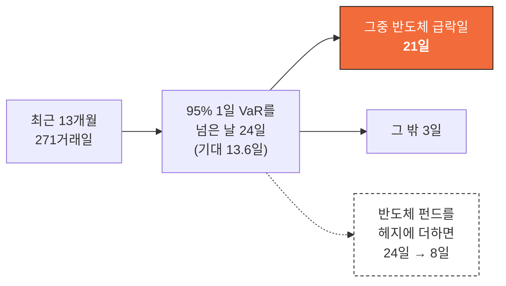
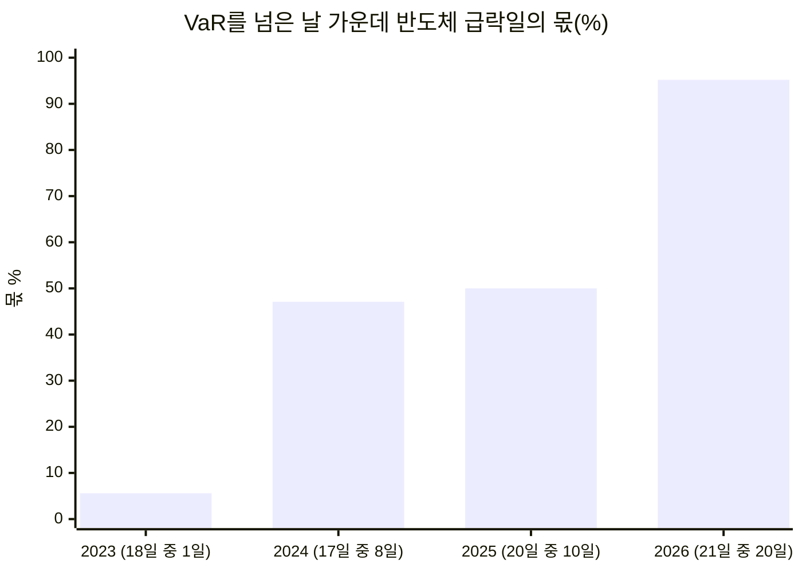
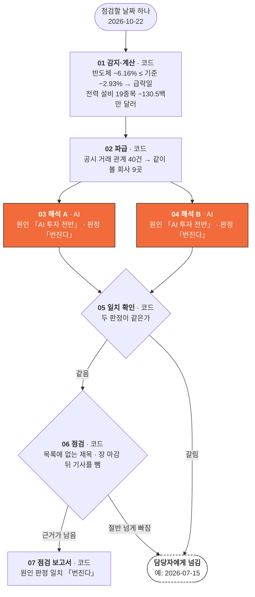
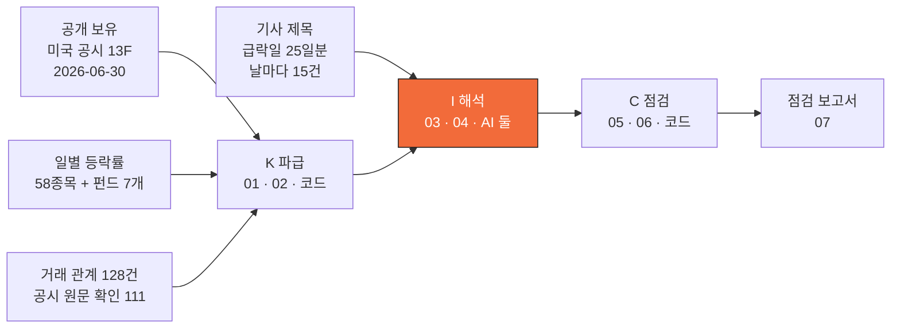
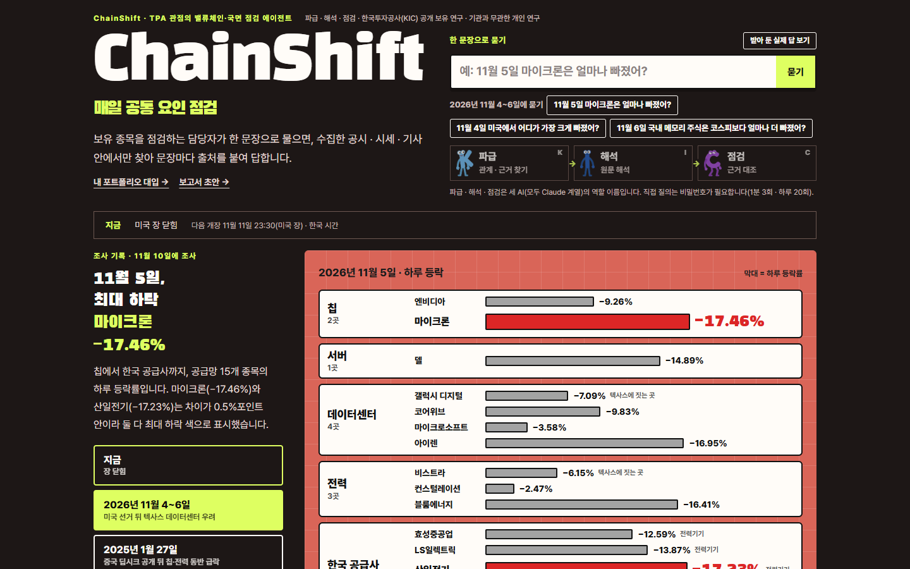

# ChainShift

반도체가 급락한 다음 날 아침, 전력 설비 주식의 추정 손익과 원인을 한 장으로 내는 점검 에이전트입니다.
KIC AI 에이전트 공모전 예선 기획서(팀 MVPY-KIC)의 코드와 실행 기록을 담았습니다.

- 공개 화면: https://ibkr.gogumalab.co.kr/kic-ask.html
- 대상: 한국투자공사가 미국 공시(13F)로 공개한 보유 가운데 AI 데이터센터 밸류체인 58종목
- 받은 그대로 다시 돌릴 수 있습니다. 망 연결과 API 키가 필요 없습니다.

## 한눈에 보기

### 문제: 전력 설비 주식이 한도를 넘은 24일 가운데 21일이 반도체 급락일



전력 설비 19종목은 업종 분류로는 산업재 · 유틸리티 · 에너지에 흩어져 있어, 업종별로 보면 한 묶음으로 보이지 않습니다. 반도체 급락일은 271거래일 가운데 46일(17%)입니다.



### 에이전트: Knock-on 파급(K) → Interpret 해석(I) → Check 점검(C)

2026-10-22 하루를 실제로 돌린 값입니다.



AI는 원인을 읽는 해석 두 칸(주황)에만 쓰고, 파급(손실 계산 · 같이 볼 회사)과 점검(근거 대조)은 코드가 합니다. 두 칸은 서로 다른 모델이 같은 입력을 따로 읽습니다. 두 판정이 갈리거나 근거가 절반 넘게 빠지면 판정하지 않고 담당자에게 넘깁니다.

- 단계마다 받은 것과 낸 것: [`agent/runs/2026-10-22/trace.md`](agent/runs/2026-10-22/trace.md)
- 그날의 점검 보고서(AI 를 API 로 직접 부른 판): [`agent/runs_api/2026-10-22/sheet.md`](agent/runs_api/2026-10-22/sheet.md) · 기획서에 실은 처음 판: [`agent/runs/2026-10-22/sheet.md`](agent/runs/2026-10-22/sheet.md)
- 담당자에게 넘긴 날: [`agent/runs/2026-07-15/`](agent/runs/2026-07-15/)

### 자료에서 보고서까지



### 공개 화면



보유 종목에 대해 한 문장으로 물으면 수집한 공시 · 시세 · 기사 안에서 찾아 출처를 붙여 답합니다. VaR와 헤지 계산은 이 저장소의 코드로 냅니다. 화면 뒤에서 도는 답 엔진의 구성(K 파급 · I 해석 · C 점검)과 실제 기록은 [docs/LIVE_AGENT.md](docs/LIVE_AGENT.md)에 있습니다.

## MCP 서버 — 누구나 붙여 쓸 수 있습니다

ChainShift가 쓰는 실시간 도구를 MCP(Model Context Protocol) 서버로 열어 두었습니다. 토큰 없이 주소만 넣으면 됩니다.

```
https://ibkr.gogumalab.co.kr/api/kic-mcp/mcp
```

MCP를 지원하는 AI 도구의 설정에 넣는 예:

```json
{
  "mcpServers": {
    "chainshift": { "type": "http", "url": "https://ibkr.gogumalab.co.kr/api/kic-mcp/mcp" }
  }
}
```

| 도구 | 하는 일 |
|---|---|
| `holdings_lookup` | 한국투자공사가 미국 공시로 낸 분기말 보유 목록(2026-06-30 기준)에서 종목 · 묶음 찾기 |
| `quote_now` | 종목의 장중 시세(전 거래일 종가 대비, 한 번에 8종목) |
| `news_search` | 기사 검색과 본문 앞부분(한 번에 5건) |
| `sec_filings` | 미국 공시 목록과 8-K 본문 앞부분 (SEC EDGAR) |
| `dart_filings` | 한국 공시 목록 (DART) |

한 인터넷 주소에서 5분에 200번까지 부를 수 있습니다. 보유 목록은 공시 기준이며 실제 계좌가 아닙니다.

## 핵심 결과

| 결과 | 값 | 다시 내는 명령 |
|---|---|---|
| VaR를 넘은 날 가운데 반도체 급락일 | 24일 중 21일 (13개월 271거래일) | `analysis/H_var/var.py` |
| 그 21일 가운데 시장 급락일이 아닌 날 | 19일 | 같은 코드 |
| 반도체 펀드를 헤지에 더했을 때 초과일 | 24일 → 8일 (같은 VaR 기준) | 같은 코드 |
| 해마다 | 2023년 18일 중 1일 → 2026년 21일 중 20일 | 같은 코드 |
| 2026-10-22 전력 설비 19종목 | 헤지 전 −130.5 · 업종 펀드 헤지 뒤 −107.7 · VaR −48 (백만 달러) | `agent/chainshift_day.py 2026-10-22` |
| 따로 읽은 두 AI의 판정 일치 | 급락일 25일 중 22일 (88%) | `analysis/B2_roles/score/score.py` |
| 두 판정이 같을 때만 판정 | 18일 중 판정 일치 10(틀림 0) · 넘김 8 | `f4/calc_f4.py` |
| 일반 AI와 견줌 (10-22 전력·냉각 11종목 손익) | 일반 AI는 5종목을 빠뜨림 · ChainShift는 11종목 모두 계산 | `analysis/G_compare/compare.py` |

수마다 뜻 · 낸 코드 · 결과 파일은 [docs/NUMBERS.md](docs/NUMBERS.md)에 있습니다. 평가 항목 다섯 가지에 맞춘 근거 표도 같은 문서에 있습니다.

용어: 기획서의 「반도체 급락일」은 코드와 기록에서 「칩 충격일」, 「원인 판정 일치」는 「확정」으로 적혀 있습니다. 같은 것을 가리킵니다.

## 다시 돌리는 법

파이썬 3.12에서 확인했습니다. 자료는 모두 `data/`에 들어 있습니다.

```
pip install pandas numpy scipy

python -X utf8 analysis/H_var/var.py               # VaR 사후 검증: 24일 · 21일 · 8일
python -X utf8 analysis/A3_hedge/hedge.py          # 헤지 수단 견줌
python -X utf8 analysis/F_dayhedge/dayhedge.py     # 날마다 헤지 뒤 손익
python -X utf8 analysis/B2_roles/score/score.py    # 두 AI 판정 채점 (25일)
python -X utf8 f4/calc_f4.py                       # 같은 채점의 18일 판
python -X utf8 agent/chainshift_day.py 2026-10-22  # 하루 점검: 원인 판정 일치
python -X utf8 agent/chainshift_day.py 2026-07-15  # 하루 점검: 담당자에게 넘김
python -X utf8 agent/chainshift_day.py 2026-10-22 --holdings examples/my_holdings_example.csv --runs runs_mine   # 내 보유 파일로 같은 점검
python -X utf8 analysis/G_compare/compare.py       # 일반 AI 답 채점
```

- 명령은 결과 파일을 같은 값으로 다시 씁니다. 값이 찍히는 자리는 [docs/NUMBERS.md](docs/NUMBERS.md)에 있습니다.
- 위 두 날의 하루 점검은 기획서에 실은 기록을 그대로 재생합니다. AI를 새로 불러 돌리려면 `--live 1 --runs runs_api`를 붙입니다(`ANTHROPIC_API_KEY`와 `pip install anthropic`. 열쇠가 없으면 Claude Code 명령줄로 부릅니다).
- 아침 자동 실행: `python -X utf8 agent/morning.py` (전날 종가를 받아 `data_live/`에 덧붙이고 점검합니다. `pip install yfinance` 필요)
- 블룸버그 단말이나 다른 주가 원천으로 바꾸는 법은 [docs/PRICES.md](docs/PRICES.md)에 있습니다.

## 폴더

```
agent/                 하루 점검 실행기와 두 날의 기록
  chainshift_day.py    실행기 (일곱 단계)
  morning.py           아침 자동 실행
  fetch_news.py        하루치 기사 제목 받기
  model_call.py        AI 직접 부르기
  runs/                기획서에 실은 두 날 (2026-10-22 판정 일치 · 2026-07-15 넘김)
  runs_api/            Anthropic API로 돌린 기록 (2026-10-22 · 2026-07-15)
  runs_live/           Claude Code 명령줄로 돌린 기록 (같은 두 날)
  runs_auto/           아침 자동 실행 기록
analysis/
  H_var/               VaR 사후 검증 (중심 수)
  A3_hedge/            헤지 수단 견줌
  F_dayhedge/          날마다 헤지 뒤 손익
  A_problem/ A2_problem/   문제 정의의 수
  B2_roles/ B_agent/   AI 판단 실험과 채점
  C2_use/              기존 상품 견줌 · 보고서 견본 계산
  G_compare/           일반 AI와 견줌
  K_kicdocs/           한국투자공사 공개 문서 인용
data/                  등락률 · 종목 분류표 · 기사 제목 · 거래 관계 (목록은 DATA.md)
f4/calc_f4.py          기획서에 실은 18일 판 계산
committee/             여러 담당자의 의견 모으기 (코드 · 시험 · 실제 실행 기록)
docs/                  수와 근거 · 주가 원천 · 공개 화면의 에이전트
```

폴더마다 `RESULT.md`에 그 폴더의 수 · 코드 · 입력을 적었습니다.

## 구현한 것

| 기능 | 코드 | 실행 기록 |
|---|---|---|
| 아침 자동 실행: 전날 종가 받기 → 급락일 감지 → 기사 받기 → 하루 점검 (화~토 08:40 한국 시각) | `agent/morning.py` · `.github/workflows/morning.yml` | `agent/runs_auto/log.jsonl` |
| 내 보유 파일로 같은 점검 보고서 — 종목과 금액(또는 수량)을 적은 파일을 넣으면 단계별 손익 · 헤지 · 한도 칸이 내 보유 기준으로 나옴 | `agent/chainshift_day.py --holdings` · 예시 `examples/my_holdings_example.csv` | `agent/runs_mine/2026-10-22/sheet.md` |
| 급락일이면 담당자에게 알림 — 그날의 점검 보고서를 저장소 알림 글(이슈)로 올려 지켜보는 사람에게 메일이 감 | `agent/alert.py` | [Issues](https://github.com/MinDongJae/chainshift/issues) |
| 아침 실행을 놓쳤을 때 예비로 깨우기 (09:17 두 번째 예약 + 09:25 PC 확인) | `tools/morning_fallback.py` | |
| 날마다 기사 제목 받기 (GDELT 15분 파일 96개 → 제목 15건. 공개 화면 기사 칸과 공개 MCP 기사 검색은 구글 뉴스 검색) | `agent/fetch_news.py` | `data/agent/kic_agent/news/` |
| AI를 실행기에 직접 연결 (Anthropic API · 열쇠가 없으면 Claude Code 명령줄) | `agent/model_call.py` · `chainshift_day.py --live 1` | `agent/runs_api/` · `agent/runs_live/` |
| 두 해석을 서로 다른 모델로 (A: claude-fable-5-2 · B: claude-opus-5-5) | 같은 코드 | `agent/runs_live/2026-10-22/trace.md` |
| 주가 원천 교체 (저장소 파일 · 야후 파이낸스 · 블룸버그 단말) | `data/fetch_prices.py` · `morning.py --source` | [docs/PRICES.md](docs/PRICES.md) |
| 여러 담당자의 의견 모으기 — 역할마다 먼저 묻고, 같은 역할 담당 2~5명이 서로 동의 · 반대를 달아 뜻을 모음 (2026-11-12 공개 화면 서버에 올림) | `committee/` | [`committee/README.md`](committee/README.md) — 운영 주소에서 확인 6건 · 실제 API 11건 |
| VaR 사후 검증 · 헤지 견줌 · 판단 실험 채점 | `analysis/` | 폴더마다 `RESULT.md` |
| 질문하면 출처를 붙여 답하는 공개 화면 | 위 주소 | |

## 자료와 라이선스

- 코드: MIT ([LICENSE](LICENSE), 저작권자 Team MVPY-KIC)
- 자료: 출처 · 수집일 · 이용 조건 · 전처리는 [DATA.md](DATA.md)에 있습니다. 기사는 두 곳에서 받습니다 — 급락일 점검은 GDELT 15분 파일, 공개 화면 기사 칸(5분마다)과 공개 MCP `news_search` 는 구글 뉴스 검색(RSS). 둘 다 제목 · 출처 · 시각 · 링크만 씁니다. 주가는 종가를 싣지 않고 일별 등락률만 실었고, 기사는 제목 · 출처 · 시각 · 주소만 실었습니다.
- AI 활용: 해석과 판단 실험은 Claude(claude-fable-5-2)가 했습니다. 계산 코드와 글 초안은 Claude Code로 만들고 사람이 읽고 고쳤습니다.
- 한국투자공사가 만든 도구가 아니며, 공개 자료로 만든 공모전 출품작입니다. 투자 권유가 아닙니다.
