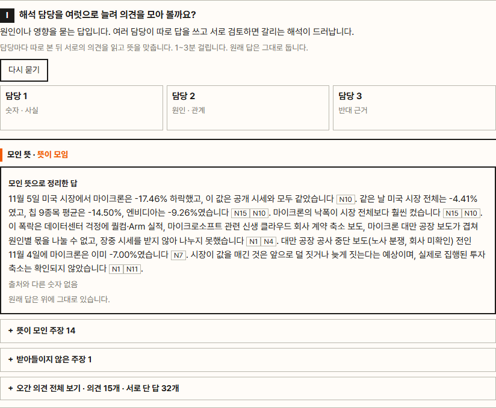

# 여러 담당자의 의견 모으기

Knock-on 파급 · Interpret 해석 · Check 점검 세 역할마다, 필요할 때 **먼저 사용자에게 묻고** 승인하면 같은 역할의 담당을 2~5명 세웁니다.
담당들은 각자 의견을 낸 뒤 서로의 의견에 동의 · 반대 · 보류와 까닭을 달고, 갈린 것만 한 번 더 봅니다. 과반이 동의한 의견만 남겨 답을 다시 정리하고, 끝까지 갈린 의견은 양쪽 까닭과 함께 따로 보입니다.

2026-11-12 09:32 공개 화면의 답 엔진 서버에 올렸습니다. 경로는 `/api/kic-agent/committee/{offers,run,cancel,decision}` 이고 로그인(공개 화면 비밀번호)이 있어야 씁니다.

## 실제로 돌린 기록

| 무엇 | 결과 |
|---|---|
| 운영 주소에서 로그인 · 실행 · 그만두기 · 횟수 상한 · 원래 묻기 | 6건 모두 통과 — [`records/prod_checks.json`](records/prod_checks.json) |
| 화면에서 승인해 운영 서버로 끝까지 (점검 · 해석) | 각 17.7초, 숫자 대조 통과 — [`records/screens/C_prod.png`](records/screens/C_prod.png) |
| 다른 질문 둘 | 「11월 6일 국내 메모리 주식은 코스피보다 얼마나 더 빠졌어?」 파급: 뜻이 모인 의견 15개 · 「11월 4일 미국에서 어디가 가장 크게 빠졌어? 왜 그랬어?」 파급: 모인 16개 · 끝까지 갈린 5개 |
| 실제 Anthropic API 시험 (거절 · 승인 · 도중 그만두기 · 시간 상한 · 잘못된 열쇠) | 11건 통과 — 실행마다 토큰과 요금 [`records/api_cost.md`](records/api_cost.md) |
| 해석 담당 셋이 주고받은 실제 기록 한 건 | [`records/run_I_example.jsonl`](records/run_I_example.jsonl) — 예: 한 담당이 「같은 자료에 Astera Labs −19.62% 가 있어 마이크론 낙폭이 가장 컸다고 쓰면 오해를 부른다」며 보류 |

## 파일

| 파일 | 하는 일 |
|---|---|
| `committee.py` | 차례와 셈 — 권할 역할 정하기(모델을 부르지 않음) · 각자 의견 · 주고받기 · 과반 세기 · 정리. 담당들에게는 한 차례씩 동시에 묻습니다 |
| `committee_api.py` | 서버 쪽 처리 — 화면이 보낸 자료를 근거 묶음과 대조해 없는 것은 뺌, 승인 · 거절 · 그만두기 기록, 모델을 부르는 길 |
| `words.json` | 역할 · 관점 · 화면 글 전부 |
| `committee.js` · `committee.css` | 화면 쪽. 답 카드 바로 아래에 붙습니다 |
| `tests/test_committee.py` | 시험 17건(모델을 부르지 않음) — `python -X utf8 committee/tests/test_committee.py` |

## 상한

한 사람 하루 5번 · 전체 하루 30번 · 한 번에 100초. 한 역할을 돌리는 데 약 11~24초, 요금은 파급 약 0.01달러 · 해석 약 0.17달러입니다(토큰 수 × 단가, 청구서 금액 아님).
