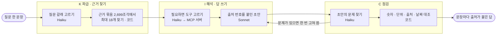

# 공개 화면에서 도는 에이전트

공개 화면(https://ibkr.gogumalab.co.kr/kic-ask.html)에 한 문장으로 물으면 도는 답 엔진의 구성과 실제 기록입니다. 2026-11-12 기준입니다.

## 질문 한 번의 흐름

| 역할 | 받는 것 → 내는 것 | 누가 |
|---|---|---|
| K 파급 | 질문 → 갈래 9개 중 하나 · 검색어 | Claude Haiku 5.5 |
| | 질문 · 검색어 → 근거 조각 최대 18개 (근거 묶음 2,699조각) | 코드 |
| I 해석 | 지금 · 오늘 · 최근 · 이번 주 질문 → 도구를 골라 기사 · 공시 · 시세 · 보유를 새로 찾음 | Claude Haiku 5.5 + MCP 서버 |
| | 질문 + 근거 → 문장마다 출처 번호가 붙은 초안 | Claude Sonnet 5.5 |
| C 점검 | 질문 + 근거 + 초안 → 문제 목록 (초안을 쓴 호출과 따로 부름) | Claude Haiku 5.5 |
| | 최종 답 + 근거 → 숫자 · 단위 · 출처 번호 · 날짜 대조 | 코드 |

## 에이전트가 스스로 정하는 것

1. 질문의 갈래 (9갈래 중 하나)
2. 어떤 도구를 어떤 입력으로 부를지 — 도구 다섯(`news_search` · `sec_filings` · `dart_filings` · `quote_now` · `holdings_lookup`), 질문당 호출 4번 · 고르기 3차례 · 50초까지
3. 초안을 고쳐 쓸지 — 점검이 문제를 찾으면 한 번 고쳐 씀
4. 답하지 않을지 — 범위 밖이거나 근거가 모자라면 답을 쓰지 않고 안내를 냄

## 실제 기록 한 건

2026-11-11 22:48:20 (한국 시각) · 질문 「이번 주 JP모건이나 블랙스톤이 낸 미국 공시 있어?」

| 단계 | 한 일 |
|---|---|
| 갈래 | 「지금」 |
| 도구 | `sec_filings(ticker=JPM, since=2026-11-09)` · `sec_filings(ticker=BX, since=2026-11-09)` — 2번, 2.9초 |
| 근거 | 조각 18개 |
| 점검 | 지적 1건 → 한 번 고쳐 씀 |
| 대조 | 검증 실패 0 · 인용 [N2~N5] |
| 걸린 시간 | 17.2초 |

## 시간과 비용

2026-11-09 이후 질의 34건 기준입니다.

| 항목 | 값 |
|---|---|
| 걸린 시간 | 중앙값 12.7초 |
| 모델 요금 | 중앙값 0.044달러 (엔진이 토큰 수와 단가로 계산한 값) |

## 도는 곳

- 답 엔진: AWS 서울 리전 Lambda. 앞에 CloudFront와 방화벽이 있습니다.
- 도구 서버: 같은 구성의 MCP 서버. 토큰 없이 주소만으로 붙일 수 있습니다 — [README](../README.md)의 「MCP 서버」.
- 공개 화면에서 새 질문을 직접 넣으려면 비밀번호가 필요합니다. 방문자는 「받아 둔 실제 답 보기」로 실제 질의 기록을 그대로 볼 수 있습니다.
